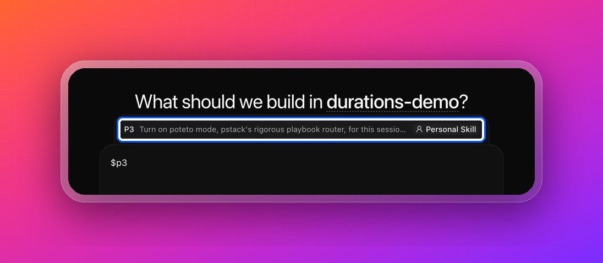
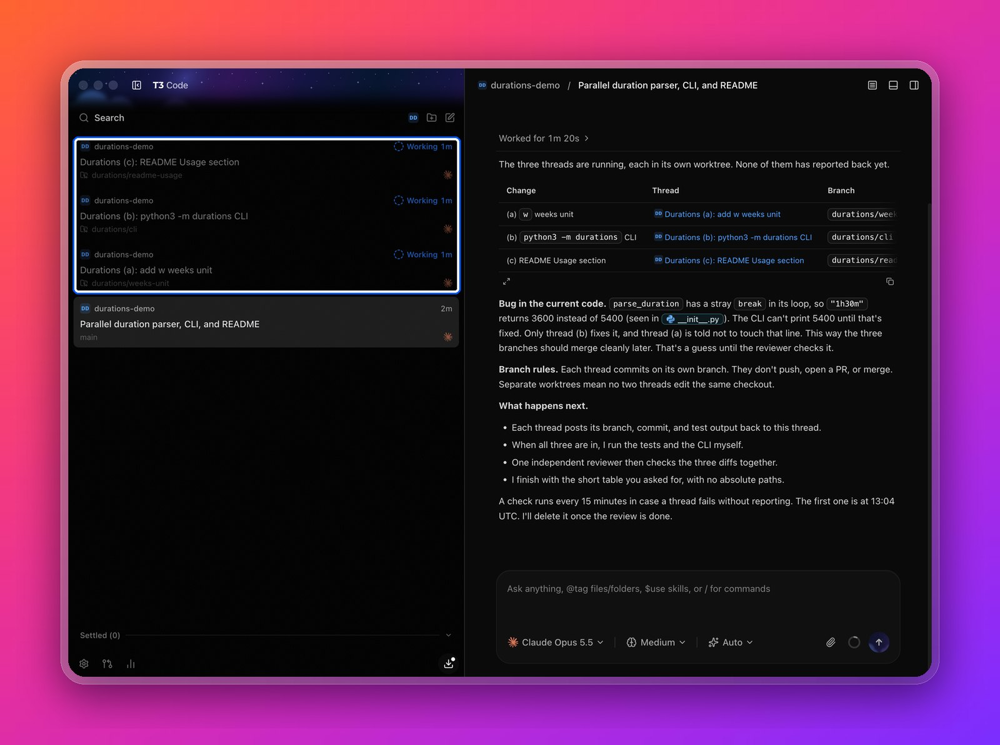
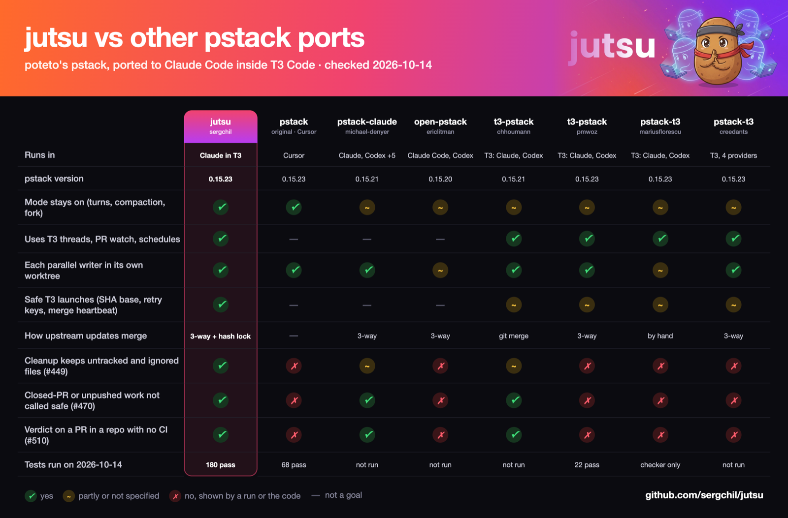

[](https://github.com/sergchil/jutsu/actions/workflows/ci.yml)
[](https://github.com/sergchil/jutsu/releases)
[](LICENSE)
[](https://github.com/anthropics/claude-code)
[](https://github.com/pingdotgg/t3code)
[](https://sergchil.github.io/jutsu/)

**jutsu** is [pstack](https://github.com/cursor/plugins/tree/main/pstack) by Lauren Tan (poteto), ported to **Claude Code inside [T3 Code](https://github.com/pingdotgg/t3code)**.

One command, `/jutsu`, turns on poteto mode. It routes each task to one of pstack 0.15.23's 23 playbooks (bug fix, feature, refactor, babysit a PR, overnight run…), applies its 24 principles, and proves the work before it calls it done. In T3 it uses T3's own tools: parallel threads in their own worktrees, PR watching, schedules, the browser, and simulators.



## Install

```sh
git clone https://github.com/sergchil/jutsu.git
cd jutsu && ./install.sh
```

Needs Claude Code 2.1.292+ and Python 3.9+. The T3 tools need T3 Code nightly from 2026-10-03; without T3, jutsu falls back to plain Claude Code. If another pstack port is installed, the installer says how to turn it off.

## Use

- Type `$jutsu <task>` in a T3 thread (or `/jutsu <task>`). Poteto mode stays on for the thread; `/jutsu off` stops it.
- More commands: `/jutsu:setup-pstack` picks models and effort per role, `/jutsu:poteto-help` says which skill fits, and `/jutsu:how`, `/jutsu:why`, `/jutsu:arena`, `/jutsu:swarm` and the rest of pstack's skills.


*One request, three changes: jutsu launches a T3 thread per change in its own worktree, then reviews all three.*

## Uninstall

```sh
./uninstall.sh
```

Removes everything jutsu added to each Claude config folder that T3 uses: the plugin link, its session state, and its settings file. Your repos are not touched. Then delete this folder.

## Update

`git pull`. When poteto releases a new pstack, a weekly GitHub workflow opens a pull request that lists exactly what to port ([docs/UPDATING.md](docs/UPDATING.md)).

## Compared with other ports (2026-10-14)



jutsu fixes three pstack bugs that are still open upstream: [#449](https://github.com/cursor/plugins/issues/449), [#470](https://github.com/cursor/plugins/issues/470), and watch-pr on a repo with no CI ([PR #510](https://github.com/cursor/plugins/pull/510)). Evidence for every cell, 11 repos, and our own known gaps: [docs/COMPARISON.md](docs/COMPARISON.md). Live tests: [docs/TESTED.md](docs/TESTED.md).

## More

[Website](https://sergchil.github.io/jutsu/) · [How it works](docs/HOW-IT-WORKS.md) · [Porting rules](docs/PORTING.md) · [Updating](docs/UPDATING.md) · [Changelog](CHANGELOG.md) · [Contributing](CONTRIBUTING.md) · [Security](SECURITY.md)

The skills, principles, and language are Lauren Tan's. The Claude Code and T3 wiring is this repo's, with ideas from the ports in [NOTICE.md](NOTICE.md). MIT, see [LICENSE](LICENSE).
